<p align="center">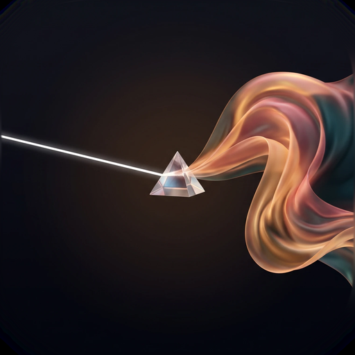</p>

<h1 align="center">VidUltra</h1>

<p align="center"><b>RAW video camera for Android.</b><br>
Every frame is developed from the sensor's RAW data on the GPU and recorded as 10-bit HEVC —
with gyro stabilization, film-like noise reduction, an iPhone-style auto look and 14 pro log profiles.</p>

<p align="center">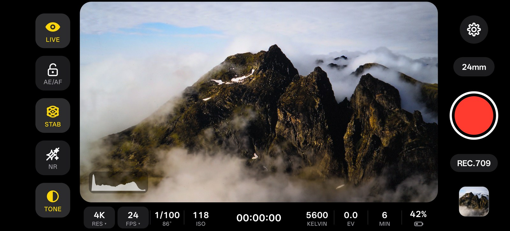</p>

> **Beta.** Developed and tuned on one phone so far. It is built to adapt to any phone with a RAW-capable
> camera, but expect rough edges on others — please report them (see [Reporting a problem](#reporting-a-problem)).

## Why

Phone cameras run every video through heavy sharpening, smoothing and HDR processing that you can't turn off.
VidUltra skips the phone's video pipeline: it reads the RAW sensor frames itself and develops them like a
cinema camera would, so the picture is soft, natural and "creamy" like film or a mirrorless camera —
or a flat log image ready for grading.

## Features

**Picture**
- RAW10 / RAW12 / RAW16 sensor frames developed on the GPU (OpenGL ES 3.2), recorded as HEVC Main10 (10-bit) or H.264 8-bit.
- **Rec.709 auto look** inspired by the iPhone: smooth auto exposure, highlight-protecting dynamic tone mapping, natural colour — without the over-sharpening.
- No artificial sharpening and no artificial smoothing. Highlight recovery keeps bright skies and lamps from clipping harshly.
- Colour from the sensor's calibration (DNG colour matrices), with fallbacks for lenses that ship weak or placeholder calibration.
- **14 log profiles** with their real gamuts: ARRI LogC3 / LogC4, Sony S-Log3, Panasonic V-Log, Fujifilm F-Log / F-Log2, Canon Log 3, Apple Log, RED Log3G10, DaVinci Intermediate, ACEScct, Nikon N-Log, DJI D-Log, HLG — plus a free gamut choice. "Show log as Rec.709" keeps the viewfinder normal while the file stays log.
- **Noise reduction**: temporal + colour, motion-aware (no ghosting), with adjustable natural film grain so it never looks plastic.

**Motion**
- **Gyro stabilization** with look-ahead, rolling-shutter correction and OIS compensation. The viewfinder stays unstabilized and responsive; the recorded file is stabilized.
- **180° shutter** for cinematic motion blur when the phone is steady, with anti-flicker for 50 / 60 Hz lights.

**Camera**
- Every camera on the phone — ultra-wide, wide, telephoto, front — with its focal length in mm.
- iPhone-style tap to focus and expose, which resets when you move to a new scene; AE/AF lock.
- 4K / 2.7K / 1080p / 720p, 16:9 / 17:9 / 2:1 / 2.39:1 / 4:3 / 1:1, 24 / 25 / 30 fps, three bitrates. Lower resolutions are downsampled from the full sensor, so older phones can still shoot clean video.

**Interface**
- Clean viewfinder — only the picture, histogram, focus box, grid and level. Every readout lives in a bar below the picture: resolution, frame rate, shutter, ISO, timer and audio meter, white balance, exposure, minutes of storage left, battery.
- Format changes restart only the camera, in about a second, without leaving the app.

<table>
<tr><td>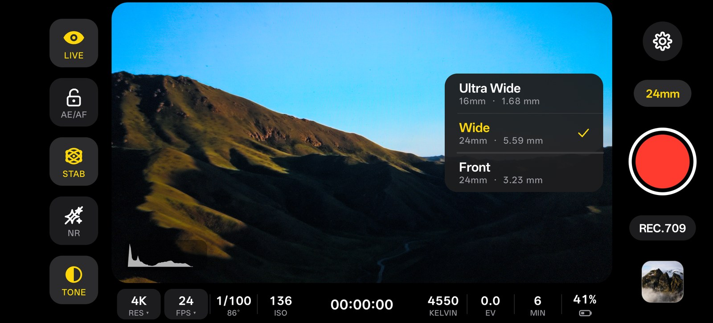</td><td>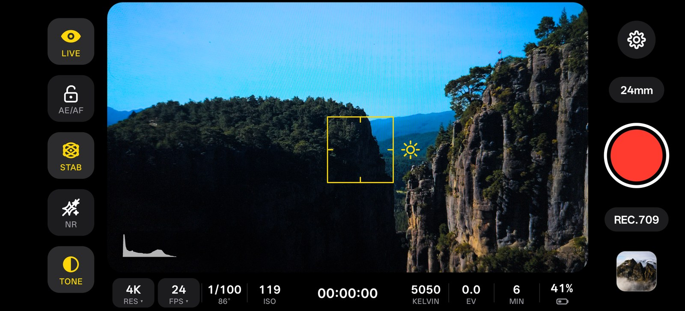</td></tr>
<tr><td align="center">Lens picker</td><td align="center">Tap to focus and expose</td></tr>
<tr><td>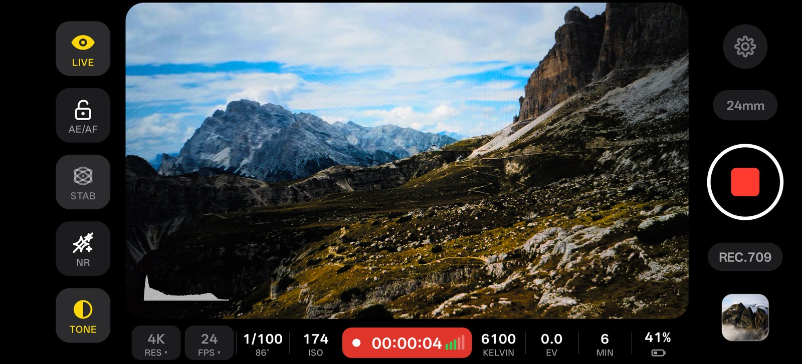</td><td>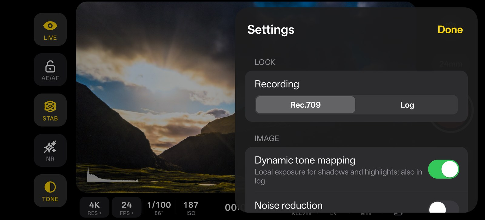</td></tr>
<tr><td align="center">Recording</td><td align="center">Settings</td></tr>
<tr><td>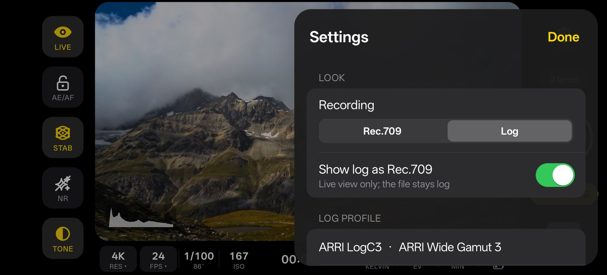</td><td>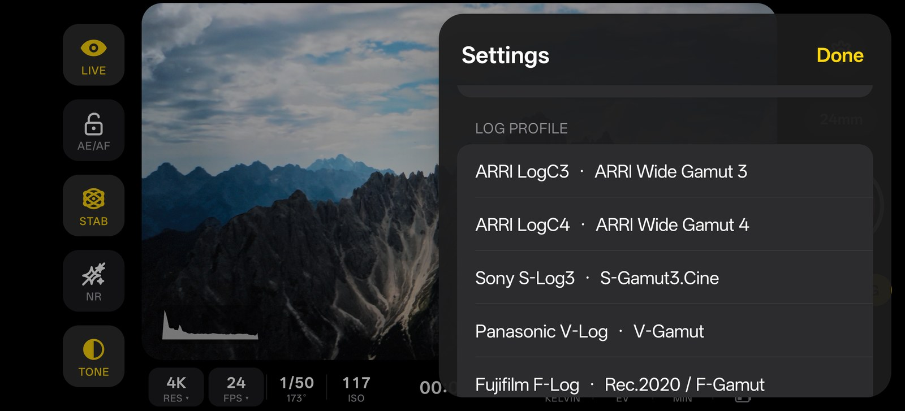</td></tr>
<tr><td align="center">Log recording</td><td align="center">14 log profiles</td></tr>
<tr><td>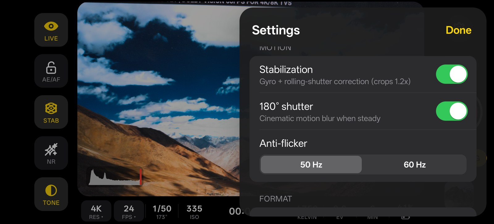</td><td>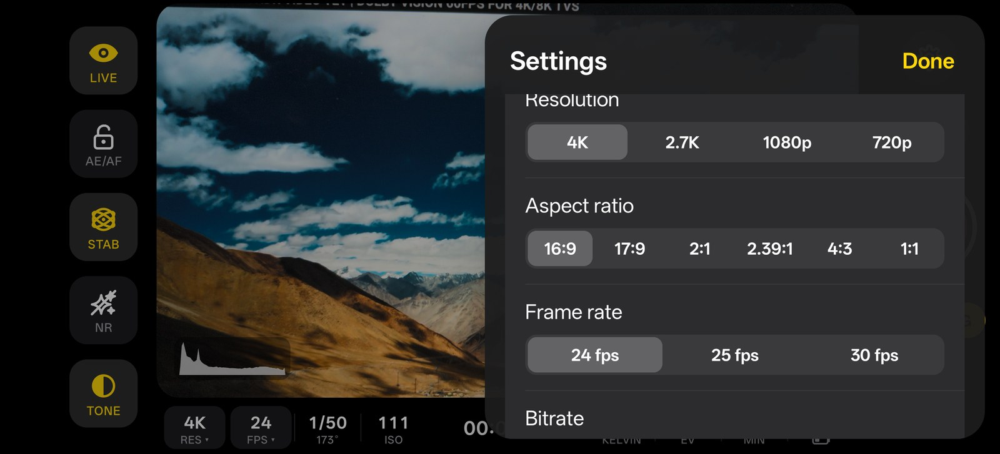</td></tr>
<tr><td align="center">Stabilization, shutter, anti-flicker</td><td align="center">Resolution, aspect ratio, frame rate</td></tr>
</table>

## Requirements

- Android 13 or newer.
- A camera that offers RAW capture to apps (Camera2 `RAW` capability). Most recent mid-range and flagship phones do.
- OpenGL ES 3.2. A 10-bit HEVC encoder is used when the phone has one, otherwise H.264 8-bit.

The app checks all of this at start and only offers the resolutions, frame rates and codecs your phone can actually record.

## Install

Download the APK from [Releases](../../releases) and open it on your phone (allow installing from your browser or file manager when asked).

## Reporting a problem

Open **Settings → Support → Copy Diagnostic Log** (or **Share**), and paste it into an [issue](../../issues).

<p align="center">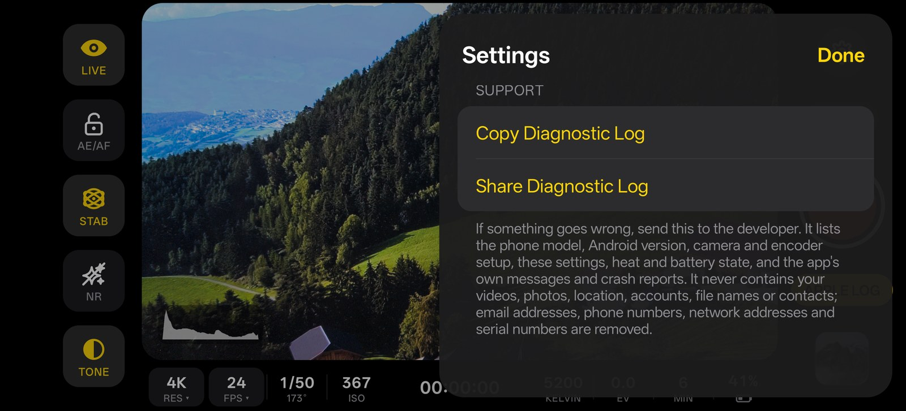</p>

The log lists the phone model, Android version, the camera and encoder setup the app chose, your settings,
heat and battery state, and the app's own messages and crash reports. It **never** contains your videos,
photos, location, accounts, file names or contacts, and email addresses, phone numbers, network addresses
and serial numbers are removed before it leaves the app. You can read the whole thing before you send it.

## Build

```bash
./gradlew assembleRelease
```

Needs JDK 17+ and the Android SDK (API 35). Without signing settings, release builds are signed with the debug key.

## License

[GPL-3.0](LICENSE) © Pixelgamer4k
